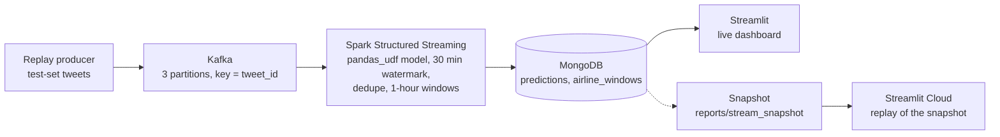

# Airline tweet sentiment stream

Right now, are each airline's customers talking positively or negatively?

## Live demo

TODO: link

The demo replays a recorded run of the pipeline; it is not live Twitter data.


## Problem → Approach → Results

- **Problem.** A customer-care team wants to see, hour by hour, when the tweets aimed at an airline turn negative, while there is still time to react.
- **Approach.** Tweets go through Kafka into a Spark Structured Streaming job. It labels each tweet negative, neutral or positive with a TF-IDF + logistic regression model and counts the labels per airline and hour. MongoDB stores both, and a Streamlit dashboard reads them.
- **Data.** 14,640 labelled tweets about six US airlines from February 2015. The model is trained on the earlier days; the stream replays the last two days, which the model never saw.
- **Model.** On those two days the model's macro-F1 is 0.7107 (95% CI 0.6945 to 0.7276), against 0.2555 for always answering "negative".
- **Stream.** One recorded replay sent 4,196 tweets and produced 4,196 predictions and 198 airline-hour windows; the watermark dropped 0 rows.
- **Consistency.** Stream predictions match the offline model on 4,196 of 4,196 tweets.
- **Speed.** Throughput and latency are not reported yet; see [Benchmark](#benchmark).

## Results

### Model on the test set

Source: `models/metrics.json`, written by `python -m src.ml.train`.

The model is trained on 10,228 tweets and scored once on the 4,196 tweets created from 2015-02-23 (US Pacific time) onwards. Duplicate texts are removed before the split, and the hyper-parameters are chosen by time-ordered cross-validation on the training tweets only (best cross-validated macro-F1: 0.7186). Intervals are 95% paired-bootstrap intervals from 1,000 resamples.

| | Accuracy | Macro-F1 [95% CI] | F1 negative | F1 neutral | F1 positive |
| --- | --- | --- | --- | --- | --- |
| Baseline: always "negative" | 0.6213 | 0.2555 [0.2519, 0.2591] | 0.7664 | 0.0000 | 0.0000 |
| TF-IDF + logistic regression | 0.7691 | 0.7107 [0.6945, 0.7276] | 0.8550 | 0.5990 | 0.6781 |
| Difference (model − baseline) | | 0.4552 [0.4367, 0.4728] | | | |

### Macro-F1 by airline

Source: `models/metrics.json`, written by `python -m src.ml.train` (test set only).

| Airline | Test tweets | Macro-F1 [95% CI] |
| --- | --- | --- |
| American | 1,608 | 0.7265 [0.6978, 0.7528] |
| Delta | 503 | 0.6048 [0.5616, 0.6498] |
| Southwest | 453 | 0.7195 [0.6751, 0.7636] |
| US Airways | 664 | 0.7167 [0.6659, 0.7589] |
| United | 849 | 0.6798 [0.6418, 0.7170] |
| Virgin America | 119 | 0.7249 [0.6396, 0.8005] |

The airlines differ in their mix of labels (neutral is the largest class among Delta's and Virgin America's test tweets, negative among the others'), so this table is not a like-for-like comparison of airlines.

### Replay of the test set through the stack

Source: `reports/stream_snapshot/meta.json`, written by `python -m scripts.export_snapshot` on a fresh stack (recorded on 2026-10-10 with `producer --speedup 600`).

| | |
| --- | --- |
| Tweets sent | 4,196 |
| Predictions stored in MongoDB | 4,196 |
| Airline-hour windows | 198 |
| Sum of the window totals | 4,196 |
| Rows dropped by the watermark | 0 |

### Stream predictions against the offline model

Source: `reports/stream_consistency.json`, written by `python -m scripts.check_stream_consistency`.

| | |
| --- | --- |
| Tweets in the recorded run | 4,196 |
| Same label from the stream and from the offline model | 4,196 |
| Accuracy of the stream's labels | 0.7691 |
| Macro-F1 of the stream's labels | 0.7107 |
| Labels assigned by the stream | 2,572 negative, 953 neutral, 671 positive |

### Benchmark

Throughput and latency are measured on a GitHub Actions runner by `.github/workflows/benchmark.yml`; results will be added to `reports/benchmark.json`.

## How it works




The dashboard has two modes and always says which one it is in: live from MongoDB when the stack is running, or a replay of the recorded run in `reports/stream_snapshot/` with a simulated clock, which is what the hosted demo shows.

Tech stack:

- Apache Kafka (KRaft, one node)
- Spark Structured Streaming (PySpark)
- MongoDB
- scikit-learn (TF-IDF + logistic regression)
- Streamlit
- Docker Compose

**Running a batch twice does not change the result.** Each prediction is stored under `_id = tweet_id` and each window under `_id = airline|window_start`, and both sinks replace the document with that id, so a re-run of a micro-batch overwrites instead of adding. A tweet delivered twice is still counted once in its window, because the window query calls `dropDuplicatesWithinWatermark` on `tweet_id` before it aggregates.

## How to run

Requires Python 3.11 (Spark 3.5) and Docker.

```bash
docker compose up -d
docker compose run --rm producer --speedup 600
# open http://localhost:8501
pytest -q
```

The first two commands start Kafka, MongoDB, the Spark job and the dashboard, then replay the test tweets at 600 times real speed. `pytest -q` needs the packages in `requirements-dev.txt`; the Spark tests are skipped when no Java runtime is installed. Without Docker, `streamlit run app.py` replays the recorded run.

## Limitations

- The data is from 2015 and covers 8 days; the test set is the last 2 of them. The scores say nothing about other periods or about tweets written today.
- The neutral class is the weakest: its F1 is 0.5990.
- The training and test days differ in their mix of airlines: American is the largest airline in the test set (1,608 of 4,196 tweets) but is under-represented in the training days.
- The stream replays tweets that were collected long ago. Nothing here is connected to Twitter.
- For this amount of data Spark is more machinery than the job needs; a single Python process would do. It is used here to show a streaming design: event time, a watermark, checkpoints.
- A tweet that arrives later than the 30-minute watermark still gets a prediction but is left out of the window counts.
- Changing `spark.sql.shuffle.partitions` requires deleting the checkpoint first (`docker compose down -v`), because a checkpoint keeps the number of partitions it was created with.
- The benchmark runs on a single GitHub Actions runner with nothing else competing for it, so it will not describe behaviour under concurrent load.
- The dashboard only flags a window as above the threshold when it has at least 20 tweets. Only the airlines with many tweets reach 20 tweets in an hour, so the flag mostly applies to them.
- The dataset is licensed CC BY-NC-SA 4.0: non-commercial use only, share-alike.

## Authors and license

- Author: Phan Thanh Tan ([@thanhtan2210](https://github.com/thanhtan2210)).
- Code: MIT, see [LICENSE](LICENSE).
- Data: [Twitter US Airline Sentiment](https://www.kaggle.com/datasets/crowdflower/twitter-airline-sentiment) (Crowdflower / Figure Eight, "Data for Everyone"), CC BY-NC-SA 4.0. The download source, checksum and what the license covers are in [data/raw/SOURCE.md](data/raw/SOURCE.md). It also applies to `reports/stream_snapshot/` and to the screenshots in `docs/images/`, which contain or are derived from tweet text.
