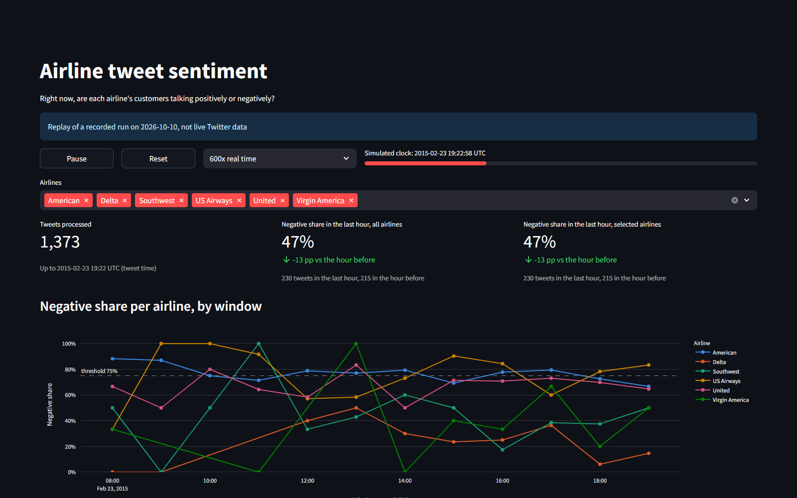
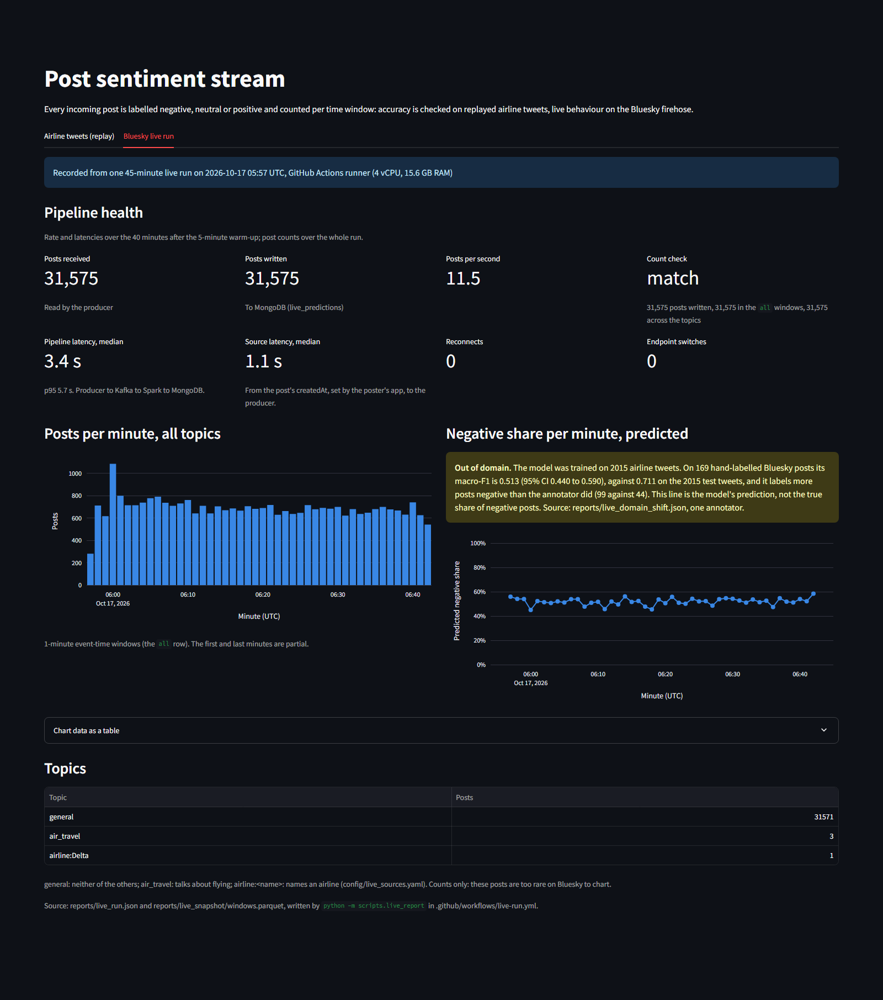
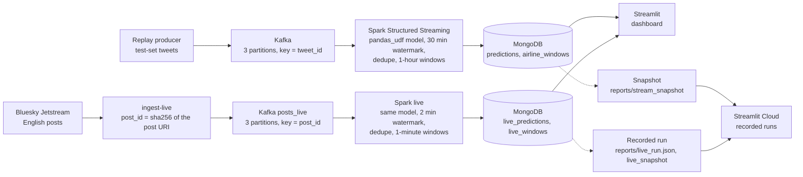
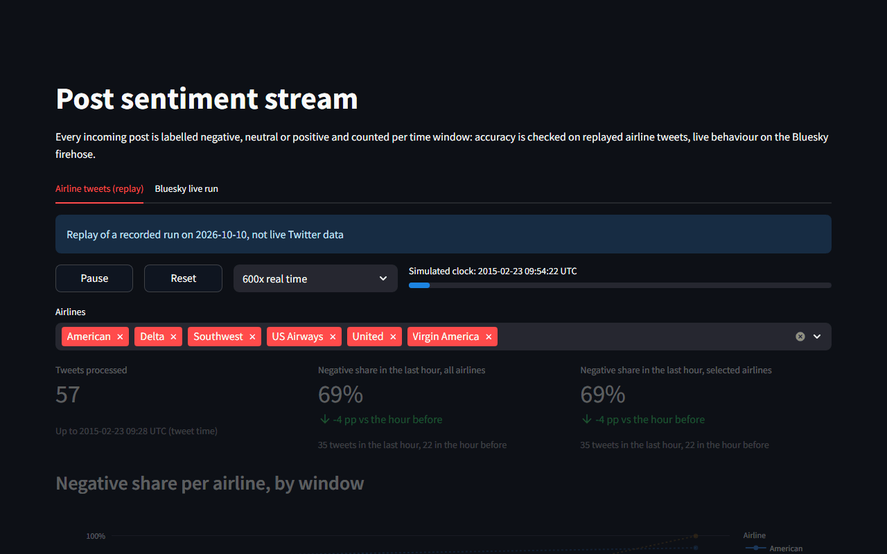

# Sentiment stream: replayed airline tweets and live Bluesky posts

Label every incoming post as negative, neutral or positive and count them per time window: accuracy is checked on replayed airline tweets, live behaviour on the Bluesky firehose.

## Live demo

Not deployed. Screenshots of the dashboard's two tabs, both showing recorded runs:





## Problem → Approach → Results

- **Problem.** A customer-care team wants to see, hour by hour, when the tweets aimed at an airline turn negative, while there is still time to react.
- **Approach.** Tweets go through Kafka into a Spark Structured Streaming job. It labels each tweet negative, neutral or positive with a TF-IDF + logistic regression model and counts the labels per airline and hour. MongoDB stores both, and a Streamlit dashboard reads them.
- **Data.** 14,640 labelled tweets about six US airlines from February 2015. The model is trained on the earlier days; the stream replays the last two days, which the model never saw.
- **Model.** On those two days the model's macro-F1 is 0.7107 (95% CI 0.6945 to 0.7276), against 0.2555 for always answering "negative".
- **Stream.** One recorded replay sent 4,196 tweets and produced 4,196 predictions and 198 airline-hour windows; the watermark dropped 0 rows.
- **Consistency.** Stream predictions match the offline model on 4,196 of 4,196 tweets.
- **Speed.** In a burst test the stack handled 1264.6 tweets per second with a median latency of 6.076 s from send to `written_at`, on a GitHub Actions runner (2 vCPU, 7.8 GB RAM); see [Benchmark](#benchmark).
- **Live.** One 45-minute run read 31,575 English Bluesky posts through the same pipeline with a median pipeline latency of 3.442 s. On 169 hand-labelled posts the model's macro-F1 falls to 0.5126, against 0.7107 on the 2015 tweets; see [Live run on Bluesky](#live-run-on-bluesky).

## Results

### Model on the test set

Source: `models/metrics.json`, written by `python -m src.ml.train`.

The model is trained on 10,228 tweets and scored once on the 4,196 tweets created from 2015-02-23 (US Pacific time) onwards. Duplicate texts are removed before the split, and the hyper-parameters are chosen by time-ordered cross-validation on the training tweets only (best cross-validated macro-F1: 0.7186). Intervals are 95% paired-bootstrap intervals from 1,000 resamples.

| | Accuracy | Macro-F1 [95% CI] | F1 negative | F1 neutral | F1 positive |
| --- | --- | --- | --- | --- | --- |
| Baseline: always "negative" | 0.6213 | 0.2555 [0.2519, 0.2591] | 0.7664 | 0.0000 | 0.0000 |
| TF-IDF + logistic regression | 0.7691 | 0.7107 [0.6945, 0.7276] | 0.8550 | 0.5990 | 0.6781 |
| Difference (model − baseline) | | 0.4552 [0.4367, 0.4728] | | | |

### Macro-F1 by airline

Source: `models/metrics.json`, written by `python -m src.ml.train` (test set only).

| Airline | Test tweets | Macro-F1 [95% CI] |
| --- | --- | --- |
| American | 1,608 | 0.7265 [0.6978, 0.7528] |
| Delta | 503 | 0.6048 [0.5616, 0.6498] |
| Southwest | 453 | 0.7195 [0.6751, 0.7636] |
| US Airways | 664 | 0.7167 [0.6659, 0.7589] |
| United | 849 | 0.6798 [0.6418, 0.7170] |
| Virgin America | 119 | 0.7249 [0.6396, 0.8005] |

The airlines differ in their mix of labels (neutral is the largest class among Delta's and Virgin America's test tweets, negative among the others'), so this table is not a like-for-like comparison of airlines.

### Replay of the test set through the stack

Source: `reports/stream_snapshot/meta.json`, written by `python -m scripts.export_snapshot` on a fresh stack (recorded on 2026-10-10 with `producer --speedup 600`).

| | |
| --- | --- |
| Tweets sent | 4,196 |
| Predictions stored in MongoDB | 4,196 |
| Airline-hour windows | 198 |
| Sum of the window totals | 4,196 |
| Rows dropped by the watermark | 0 |

### Stream predictions against the offline model

Source: `reports/stream_consistency.json`, written by `python -m scripts.check_stream_consistency`.

| | |
| --- | --- |
| Tweets in the recorded run | 4,196 |
| Same label from the stream and from the offline model | 4,196 |
| Accuracy of the stream's labels | 0.7691 |
| Macro-F1 of the stream's labels | 0.7107 |
| Labels assigned by the stream | 2,572 negative, 953 neutral, 671 positive |

### Benchmark

Source: `reports/benchmark.json`, measured by `.github/workflows/benchmark.yml`, which runs `scripts/benchmark_stream.py` and `scripts/benchmark_udf.py` (2026-10-13, commit `42fb31c`).

Machine: one GitHub Actions runner, 2 vCPU, 7.8 GB RAM, INTEL(R) XEON(R) PLATINUM 8573C, Docker 28.0.4; trigger 5 seconds, 3 topic partitions, Spark limited to 2048 MB.

**Streaming.** After an untimed warm-up, the whole test set was replayed 5 times at maximum rate: 20,980 tweets sent in 11.885 s.

| | |
| --- | --- |
| Tweets | 20,980 |
| First send to last write | 16.590 s |
| Throughput | 1264.6 tweets per second |
| Latency from send to `written_at`: p50 / p95 / p99 | 6.076 s / 8.943 s / 9.096 s |
| Latency from send to MongoDB acknowledgement: p50 / p95 / p99 | 8.179 s / 11.046 s / 11.199 s |
| Rows dropped by the watermark | 0 |

Throughput is tweets divided by the time from the first send to the last write. `written_at` is stamped after the model has run on a micro-batch, just before its MongoDB write starts; the second latency adds the time that write took.

**Micro-batches**, from Spark's `StreamingQueryProgress`:

| Query | Micro-batches | `addBatch` median / p95 | `triggerExecution` median / p95 |
| --- | --- | --- | --- |
| predictions | 3 | 5805.0 ms / 6166.8 ms | 6122.0 ms / 6644.9 ms |
| airline_windows | 3 | 5281.0 ms / 6780.4 ms | 5879.0 ms / 7103.0 ms |

Only 3 micro-batches carried the load, so each p95 is close to the slowest batch.

**`udf` against `pandas_udf`.** A Spark batch job scores 20,980 rows in 2 partitions with each variant, three timed runs after a warm-up:

| Variant | Runs | Median | Rows per second |
| --- | --- | --- | --- |
| `udf`: one model call per row | 8.915 s, 8.597 s, 9.268 s | 8.915 s | 2,353 |
| `pandas_udf`: one model call per Arrow batch | 1.028 s, 0.838 s, 0.595 s | 0.838 s | 25,036 |

The median `pandas_udf` run took 10.64 times less time than the median `udf` run.

### Live run on Bluesky

Source: `reports/live_run.json`, written by `python -m scripts.live_report` in `.github/workflows/live-run.yml`.

English posts from the public Bluesky Jetstream went through the live profile of the same stack (own topic, collections and checkpoints). Rate and latencies are over the 27,663 posts received after the 5-minute warm-up.

| | |
| --- | --- |
| Run | 2026-10-17 05:57 to 06:42 UTC, 45.23 minutes (5 of warm-up), commit `1d55867` |
| Machine | one GitHub Actions runner, 4 vCPU, 15.6 GB RAM, AMD EPYC 9V74 80-Core Processor |
| Posts received by the producer / sent to Kafka / read by Spark / written to MongoDB | 31,575 / 31,575 / 31,575 / 31,575 |
| Dropped as duplicate / as late | 0 / 0 |
| Count check: posts written = window totals of `all` = window totals of the topics | 31,575 = 31,575 = 31,575 (46 windows): match |
| Posts per second: mean / median by minute / p95 by minute | 11.46 / 11.433 / 12.66 |
| Source latency, `received_at − created_at`: p50 / p95 / p99 | 1.098 s / 9.813 s / 54.039 s |
| Pipeline latency, `written_at − received_at`: p50 / p95 / p99 | 3.442 s / 5.651 s / 6.009 s |
| End-to-end latency, `written_at − created_at`: p50 / p95 / p99 | 4.915 s / 13.339 s / 57.211 s |
| Reconnects / endpoint switches / failed connection attempts | 0 / 0 / 0 |

`created_at` is the post's own `createdAt`, set by the poster's app; `received_at` is when the producer read it from Jetstream; `written_at` is stamped by Spark just before the MongoDB write. The containers' clock was 0.002 s off by SNTP.

Source: `reports/live_domain_shift.json`, written by `python -m scripts.eval_live_labels`.

The model was not retrained. 200 posts drawn at random from the run (after the warm-up) were labelled by one person without seeing the model's label; 31 were marked skip, leaving 169. Intervals are 95% paired-bootstrap intervals from 1,000 resamples.

| | Posts | Accuracy | Macro-F1 [95% CI] | Labels: negative / neutral / positive |
| --- | --- | --- | --- | --- |
| Hand labels (one annotator) | 169 | | | 44 / 60 / 65 |
| Baseline: always "positive" | 169 | 0.3846 | 0.1852 [0.1592, 0.2087] | 0 / 0 / 169 |
| TF-IDF + logistic regression | 169 | 0.5148 | 0.5126 [0.4395, 0.5898] | 99 / 39 / 31 |
| Same model on the 2015 test tweets | 4,196 | 0.7691 | 0.7107 [0.6945, 0.7276] | 2,572 / 953 / 671 |

On Bluesky the model calls 99 posts negative where the annotator saw 44: 33 of the 60 neutral posts and 28 of the 65 positive ones are labelled negative.

## How it works





The dashboard has one tab per mode, and each tab says where its data comes from. The replay tab reads MongoDB when the stack is running, or replays the recorded run in `reports/stream_snapshot/` with a simulated clock. The live tab reads MongoDB while the live profile runs, or the recorded Bluesky run in `reports/live_run.json` and `reports/live_snapshot/`; it shows counts, rates and latencies, never a post's text.

Tech stack:

- Apache Kafka (KRaft, one node)
- Spark Structured Streaming (PySpark)
- MongoDB
- scikit-learn (TF-IDF + logistic regression)
- Streamlit
- Docker Compose

**Running a batch twice does not change the result.** Each prediction is stored under `_id = tweet_id` and each window under `_id = airline|window_start`, and both sinks replace the document with that id, so a re-run of a micro-batch overwrites instead of adding. A tweet delivered twice is still counted once in its window, because the window query calls `dropDuplicatesWithinWatermark` on `tweet_id` before it aggregates. Live mode does the same with `_id = post_id` and `_id = topic|window_start`, and drops a repeated `post_id` before the model, because after a reconnect the producer reads the last 5 seconds again.

## How to run

Requires Python 3.11 (Spark 3.5) and Docker.

```bash
docker compose up -d
docker compose run --rm producer --speedup 600
# open http://localhost:8501
pytest -q
```

The first two commands start Kafka, MongoDB, the Spark job and the dashboard, then replay the test tweets at 600 times real speed. `pytest -q` needs the packages in `requirements-dev.txt`; the Spark tests are skipped when no Java runtime is installed. Without Docker, `streamlit run app.py` shows the recorded runs. Live mode: `make live-up` starts Kafka, MongoDB, the Bluesky ingest and the live Spark job (`make live-down` stops it and deletes its data).

## Limitations

- The data is from 2015 and covers 8 days; the test set is the last 2 of them. The scores say nothing about other periods or about tweets written today.
- The neutral class is the weakest: its F1 is 0.5990.
- The training and test days differ in their mix of airlines: American is the largest airline in the test set (1,608 of 4,196 tweets) but is under-represented in the training days.
- The stream replays tweets that were collected long ago. Nothing here is connected to Twitter.
- For this amount of data Spark is more machinery than the job needs; a single Python process would do. It is used here to show a streaming design: event time, a watermark, checkpoints.
- A tweet that arrives later than the 30-minute watermark still gets a prediction but is left out of the window counts.
- Changing `spark.sql.shuffle.partitions` requires deleting the checkpoint first (`docker compose down -v`), because a checkpoint keeps the number of partitions it was created with.
- The benchmark is a burst on a single 2-vCPU GitHub Actions runner with nothing else running. Its 3 micro-batches took a median of 6122.0 ms, longer than the 5-second trigger, so the latency it reports is mostly the time to work off a backlog. It is not the latency at a steady, slower rate, where the wait for the next trigger matters more and which this benchmark does not measure, and it says nothing about behaviour under concurrent load.
- The dashboard only flags a window as above the threshold when it has at least 20 tweets. Only the airlines with many tweets reach 20 tweets in an hour, so the flag mostly applies to them.
- The dataset is licensed CC BY-NC-SA 4.0: non-commercial use only, share-alike.
- The live labels come from one annotator: of 200 posts, 31 were skipped and 169 scored. Agreement between annotators is not measured.
- The English filter trusts the language the poster's app declares (`langs`); some of the skipped posts were not in English.
- On Bluesky the model labels too many posts negative (99 of 169, against 44 by the annotator), so the negative share in the live tab is the model's prediction, not the true share.
- There is one live run of 45 minutes, from 05:57 to 06:42 UTC (01:57 to 02:42 US Eastern time). The post rate depends on the time of day.
- Posts about flying are rare on Bluesky: in the run, 1 of 31,575 posts named an airline and 3 talked about flying. So the live mode does not follow each airline.
- Source latency starts at `createdAt`, which the poster's app sets; a wrong device clock or a post published late shows up in it, which is why its p99 is 54.039 s.
- An earlier live run (Actions run 38922308228, 2026-10-16) failed its count check; its report is `reports/live_run_2026-10-16_mismatch.json`. The producer sent 82,529 posts and Spark read 82,529; 1 was dropped as a duplicate and 0 as late, leaving 82,528. The window totals agree with that (82,528 in the `all` rows, 82,528 across the topics), but `live_predictions` holds 82,526 posts: 2 posts are counted in the windows and missing from the predictions. The cause was not found. The run reported above passed the same check.

## Authors and license

- Author: Phan Thanh Tan ([@thanhtan2210](https://github.com/thanhtan2210)).
- Code: MIT, see [LICENSE](LICENSE).
- Live posts are not stored in the repository: `reports/` holds only aggregate counts, rates and latencies, and the labelled sample was kept outside it.
- Data: [Twitter US Airline Sentiment](https://www.kaggle.com/datasets/crowdflower/twitter-airline-sentiment) (Crowdflower / Figure Eight, "Data for Everyone"), CC BY-NC-SA 4.0. The download source, checksum and what the license covers are in [data/raw/SOURCE.md](data/raw/SOURCE.md). It also applies to `reports/stream_snapshot/` and to the screenshots in `docs/images/`, which contain or are derived from tweet text.
